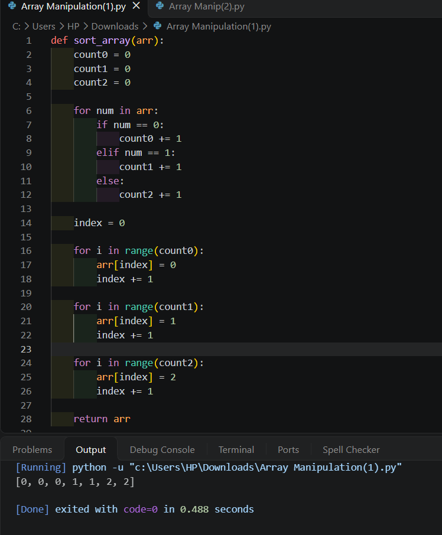
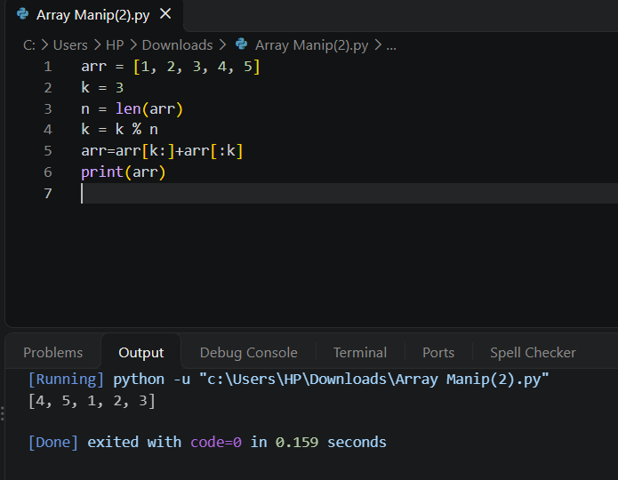
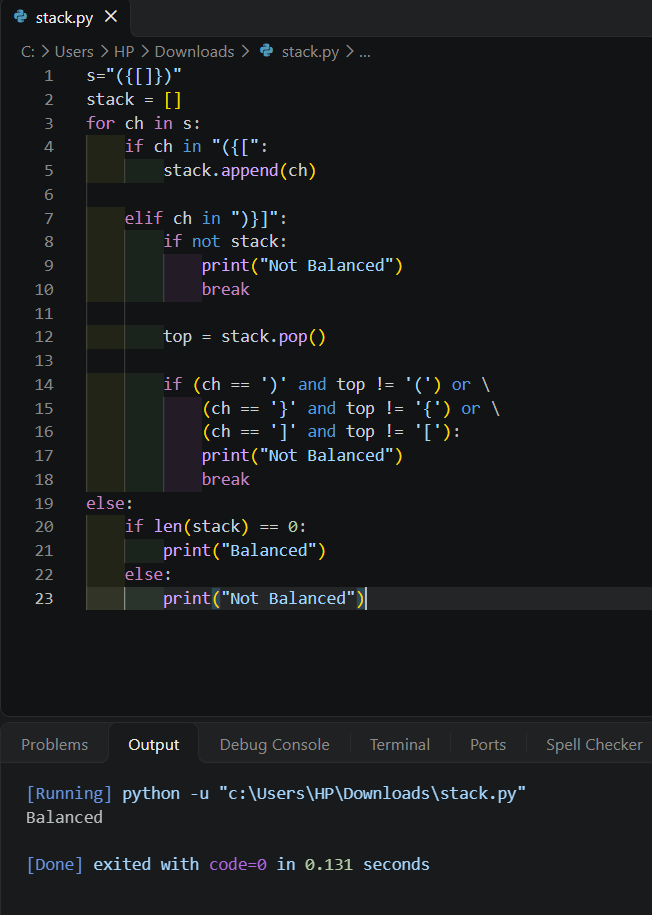
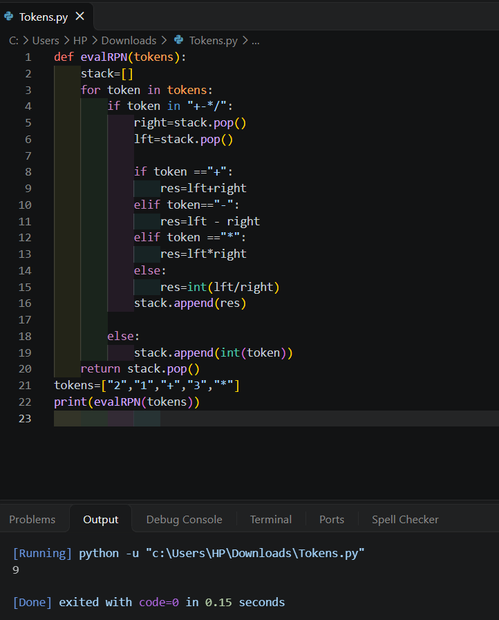

# Coding-Practice
A collection of my coding practice and work progress.

Question 1: Sort an Array Containing 0, 1 and 2
Given an array containing only 0s, 1s, and 2s, sort the array in ascending order without using the built-in sorting function.

Example:

Input:  [0, 2, 1, 2, 0, 1, 0]

Output: [0, 0, 0,1, 1, 2, 2]

Approach: Counting Method

Question 2:Given an array and an integer k, rotate the array to the right by k steps
efficiently.

Example:
Input: [1, 2, 3, 4, 5]
Output: [4, 5, 1, 2, 3]

Given a string of brackets like "({[]})", use a list as a stack to determine
if the string is balanced.

Approach: Stack(LIFO)
Example:
Input: "({[]})"
Output: Balanced

Question 3: Given tokens of an RPN expression (e.g., ["2","1","+","3","*"]), use a list
as a stack to compute the result.

